# Grafeno performance

How fast Grafeno is, how much memory it needs, and where its limits are,
measured. Every chart below is drawn from a CSV file in [`data/`](data/README.md)
by [`charts/build.py`](charts/build.py); the experiments, the code that runs
them and the discussion of each are in [benchmarks](benchmarks.md), and the
design behind the numbers in [`DESIGN.md`](../DESIGN.md) ("Measurements and
test environments").

## At a glance

| | |
| --- | --- |
| Read a node | 1.6 µs |
| Neighbors of a node | 25 µs |
| Full-text search (BM25, top 10 of 10 000) | 0.27 ms |
| Vector search (top 10 of 1 000 000, 128 dimensions) | 5 ms, 140 MiB resident |
| A durable write (immediate durability, under 4 000 writes/s) | about 2 ms |
| Most writes per second (immediate / eventual durability) | about 11 000 / 16 000 |
| A graph of 1 M nodes and 10 M edges | fits in 512 MiB |
| Hostile queries (cartesian products, huge loops, deep nesting) | 32 of 32 stopped within their limits |

## Test environments

| Id | Where | Storage |
| --- | --- | --- |
| **E1-mem** | Laptop: AMD Ryzen 7 7435HS (8 cores, 16 threads), 32 GB, Windows 11 | in memory: no file, no fsync |
| **E1-disk** | The same laptop | a file on an NVMe SSD; immediate durability is an fsync per commit |
| **E2** | The same laptop, Linux containers (Docker on WSL2) with a hard memory limit of 2 GiB or 512 MiB and no swap | a Docker volume (behind a virtual disk: slower than E1-disk) |

Release builds of Rust 1.99 and redb 4.4, one run per configuration, in
November 2026. The laptop varies by about ±20% between runs, so only
larger differences mean something; E2's times are pessimistic and its
memory numbers are the point. Not yet measured: Linux on bare metal,
spinning disks, ARM, many concurrent readers against a busy writer, and
runs of several days.

## Writes

Every write goes through one writer, which groups the writes waiting into
one transaction and one commit (group commit). With immediate durability a
commit waits for the disk, and the group shares that wait.

<picture>
  <source media="(prefers-color-scheme: dark)" srcset="assets/charts/write-latency-p99-dark.svg">
  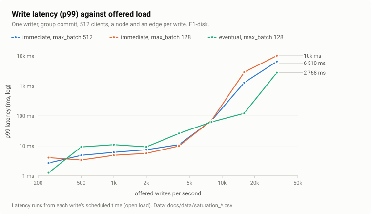
</picture>

Load is offered at a fixed rate whatever the answers, and latency runs
from each write's scheduled time, so falling behind shows. With immediate
durability a write takes about 2 ms (p50) and stays under 10 ms at p99 up
to about 4 000 writes a second: groups grow with the load, which keeps
latency flat. With eventual durability (commits reach the disk within
0.5 s) the median is 0.15 ms; its p99 is the flush every 500 ms, which
holds the writer for 10 to 25 ms.

<picture>
  <source media="(prefers-color-scheme: dark)" srcset="assets/charts/write-throughput-dark.svg">
  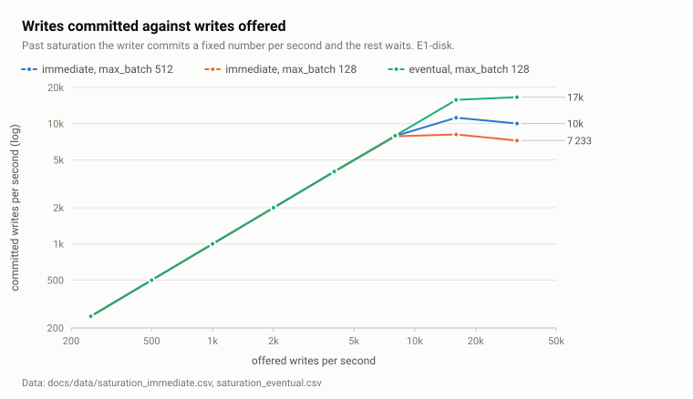
</picture>

Past saturation the writer commits a fixed number per second and the rest
waits in its queue. At high load every group is full, so the group size
(`max_batch`) bounds throughput: 128 writes per commit saturate at about
8 000 writes a second, 512 (the default) at about 11 000. A full queue
(4 096 writes) answers 503 with `Retry-After`; `GET /v1/metrics` shows the
queue, group sizes and latencies.

<picture>
  <source media="(prefers-color-scheme: dark)" srcset="assets/charts/concurrent-writes-dark.svg">
  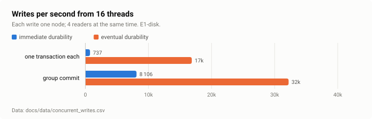
</picture>

### Imports and agents at the same time

<picture>
  <source media="(prefers-color-scheme: dark)" srcset="assets/charts/import-interference-dark.svg">
  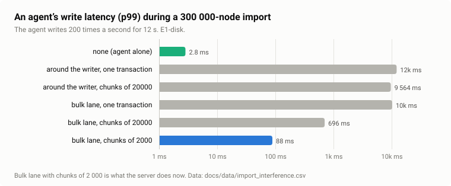
</picture>

Imports, rebuilds and compactions go through a bulk lane: one transaction
per chunk, taken between the groups of interactive writes. An agent writing
200 times a second while 300 000 nodes are imported waits 36 ms at the
median and 88 ms at p99 (chunks of 2 000, `POST /v1/import?bulk=true`),
instead of the whole import (about 12 s). An import in one transaction
(all or nothing) still holds the writer for as long as it runs.

## Search

<picture>
  <source media="(prefers-color-scheme: dark)" srcset="assets/charts/hnsw-latency-dark.svg">
  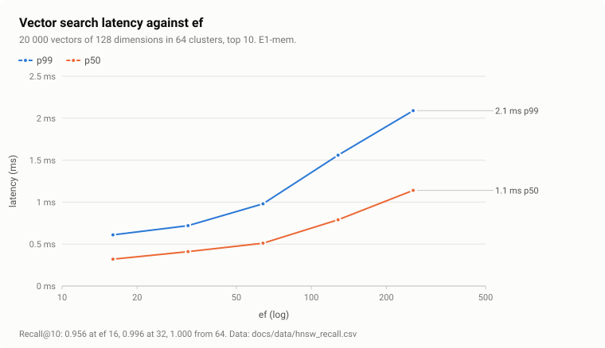
</picture>

Vector search uses an HNSW graph. On 20 000 vectors of 128 dimensions in
clusters, recall@10 (the share of the true 10 nearest found) is 0.956 at
`ef` 16, 0.996 at 32 and 1.000 from 64 (the default), where a search takes
0.51 ms (p50). On 1 000 000 vectors a search takes about 5 ms and needs
140 MiB of memory.

| `ef` | 16 | 32 | 64 | 128 | 256 |
| --- | --- | --- | --- | --- | --- |
| recall@10 | 0.956 | 0.996 | 1.000 | 1.000 | 1.000 |
| p50 / p99 (ms) | 0.32 / 0.61 | 0.41 / 0.72 | 0.51 / 0.98 | 0.79 / 1.56 | 1.14 / 2.09 |

<picture>
  <source media="(prefers-color-scheme: dark)" srcset="assets/charts/hnsw-churn-dark.svg">
  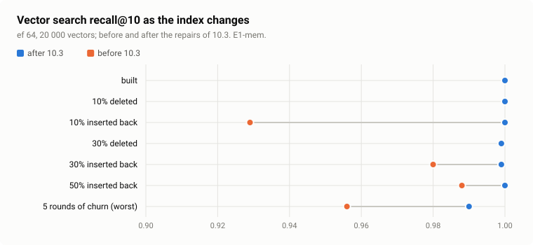
</picture>

Search quality holds as vectors are deleted, inserted back and moved:
recall@10 stays at 0.99 or more at `ef` 64 (it fell to 0.929 before the
repairs of phase 10.3). `grafeno check --recall 100` estimates it on your
own data, and `grafeno compact` rebuilds a namespace's graph.

<picture>
  <source media="(prefers-color-scheme: dark)" srcset="assets/charts/vector-insert-dark.svg">
  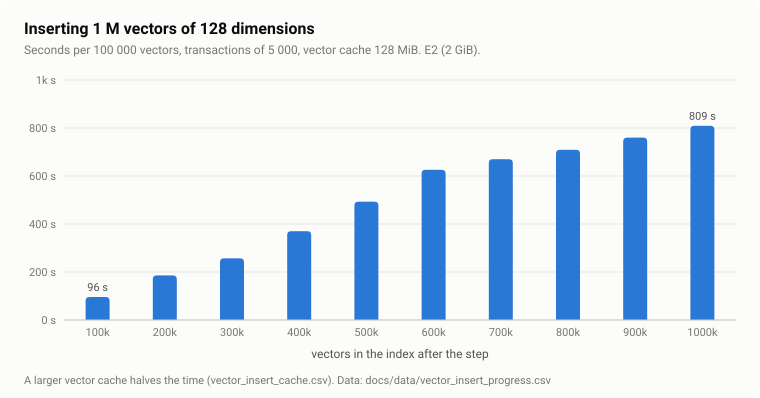
</picture>

Inserting vectors gets slower as the index grows: each insert searches a
larger graph, and the file outgrows the page cache. A million vectors took
83 minutes in E2. A larger vector cache halves the time (300 000 vectors:
539 s with 128 MiB, 284 s with 1 GiB): set `vector_cache_mb` and write
embeddings in large transactions when loading many.

<picture>
  <source media="(prefers-color-scheme: dark)" srcset="assets/charts/property-index-dark.svg">
  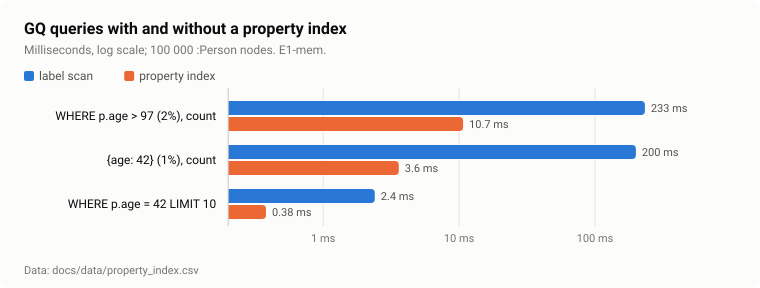
</picture>

A property index (`CREATE INDEX FOR (p:Person) ON (p.age)`) turns a label
scan of 100 000 nodes (about 2 µs a node) into a range read: 20 to 55 times
faster for selective conditions.

## The engine

<picture>
  <source media="(prefers-color-scheme: dark)" srcset="assets/charts/engine-dark.svg">
  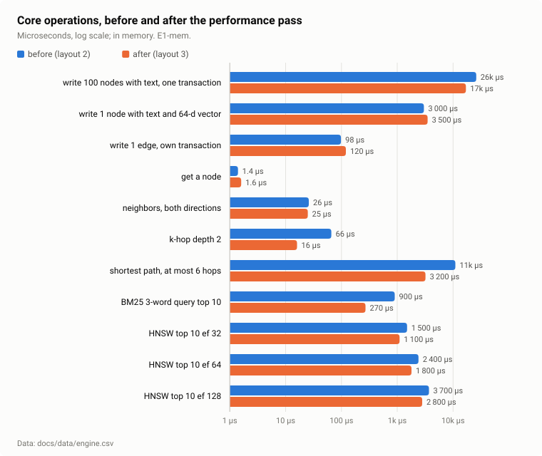
</picture>

Reads take microseconds: a node 1.6 µs, the neighbors of a node 25 µs, a
two-hop neighborhood 16 µs. Traversals read only adjacency entries, which
carry each edge's times, so filters by time need no edge records.

<picture>
  <source media="(prefers-color-scheme: dark)" srcset="assets/charts/algorithms-dark.svg">
  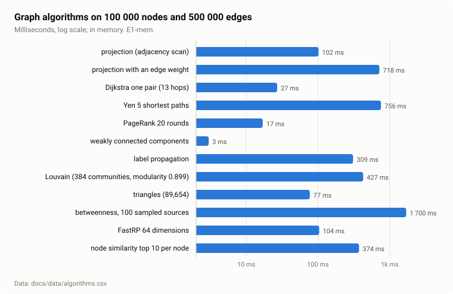
</picture>

Graph algorithms run on a projection of the namespace in memory (about 12
bytes per edge), built in one scan of the adjacency and kept until the next
commit. In GQ the scoring algorithms take `top: n` so that only the best
rows are read.

## Memory

A graph of 1 million nodes and 10 million edges (a 6.4 GB file), in
containers whose memory limit kills the process if it is crossed.

<picture>
  <source media="(prefers-color-scheme: dark)" srcset="assets/charts/memory-512-dark.svg">
  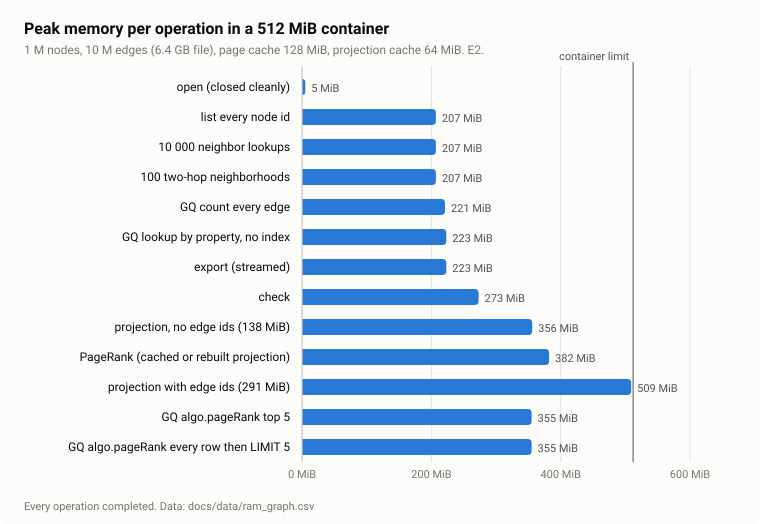
</picture>

In 512 MiB, with a 128 MiB page cache and a 64 MiB projection cache, every
operation completes: reads, queries, export, the integrity check, PageRank,
and a projection with edge ids for path algorithms (509 MiB at its peak).
The price of small caches is time: a projection that does not fit in its
cache is rebuilt for each algorithm call (about a minute here), and GQ
algorithms then reach the 30 s query timeout.

<picture>
  <source media="(prefers-color-scheme: dark)" srcset="assets/charts/memory-2g-dark.svg">
  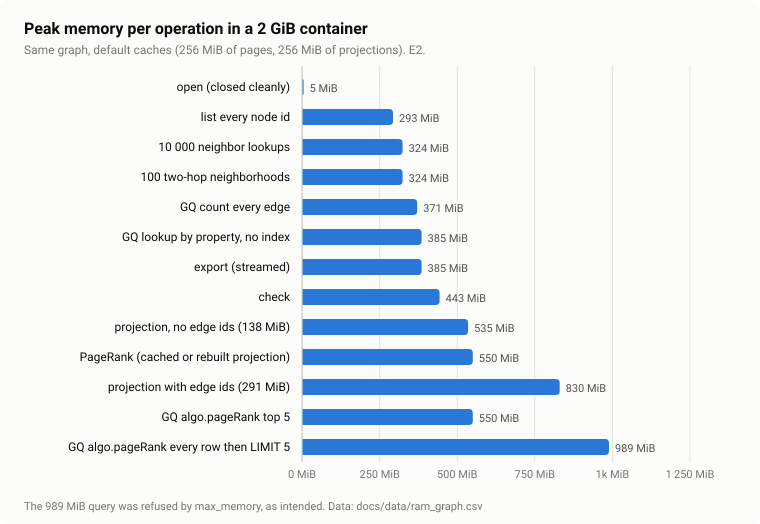
</picture>

With the default caches (256 MiB of pages, 256 MiB of projections) a
server holding this graph stays near 300 MiB outside graph algorithms. The
989 MiB query asked for a row per node (a million node records) and was
refused by its `max_memory` limit, as intended; `top: 5` answers it in
1.9 s without growing.

<picture>
  <source media="(prefers-color-scheme: dark)" srcset="assets/charts/check-cost-dark.svg">
  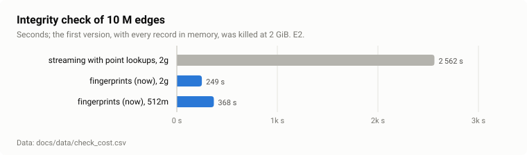
</picture>

`grafeno check` reads every record and every index once, in order, and
compares them by fingerprints, so it needs little memory and no random
reads: 249 s for 10 M edges (443 MiB at its peak). Its first version held
every record in memory and was killed at 2 GiB.

Sizing: Grafeno's memory is mostly its caches, set in `[memory]`
(`grafeno.toml`). Everything else is per request and bounded by the
`[query]` limits. See [install](install.md#memory).

## Limits that hold under abuse

<picture>
  <source media="(prefers-color-scheme: dark)" srcset="assets/charts/hostile-queries-dark.svg">
  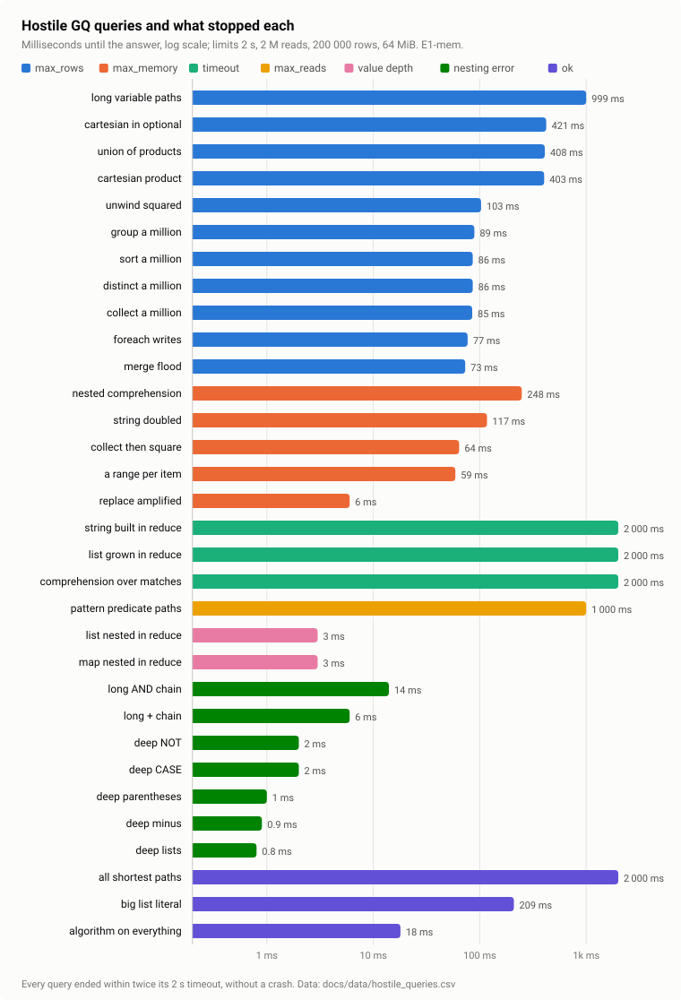
</picture>

Each GQ query runs within limits of time, records read, rows held, memory
and (optionally) estimated cost, and the parser refuses expressions nested
more than 200 levels deep. 32 hostile queries (cartesian products,
ten-hop paths, million-row sorts, strings doubled forty times, lists nested
100 000 deep, 50 000-term chains) each end with an error naming the limit
in at most 2 s, on the stack of a server worker; a fuzz test feeds random
text to the parser and planner and none panics.

## Correctness

Speed is measured with benchmarks; correctness with tests that run on
every change (about 210, plus the client's): property tests that compare
the engine with a plain model, processes killed in the middle of writes,
databases written by every past version, damaged files, concurrent
readers, isolation between API keys, and fuzzing. `DESIGN.md` lists which
test holds each guarantee.

## Reproducing

The commands for every experiment are in `DESIGN.md` ("Reproducing"); then

```bash
python docs/charts/build.py
```

redraws the charts from `docs/data/`.
